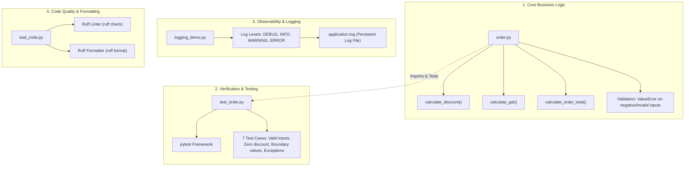
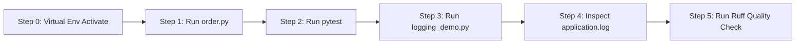

# Automated Testing, Application Logging & Code Quality Framework
### Practical Portfolio: Software Testing & Quality Assurance

| Metric | Details |
|---|---|
| **Student Name** | **Shivam Gupta** |
| **Roll Number** | **29** |
| **Course / Subject** | Python Programming (Practical 09) |
| **Toolchain** | Python 3.10+, pytest, Ruff Linter, Standard Logging |

The practical covers:

1. Unit Testing using `pytest`.
2. Testing valid and invalid inputs.
3. Handling expected exceptions using `pytest.raises()`.
4. Python Logging using DEBUG, INFO, WARNING, ERROR and CRITICAL levels.
5. Code quality checking using Ruff.
6. Automatic code formatting using Ruff.

---

# 1. Project Architecture (Kaise Design Hua Hai)

Ye project software engineering ke 4 main pillars par based hai: **Core Logic**, **Automated Testing**, **Observability (Logging)**, aur **Static Code Analysis (Linter/Formatter)**.



---

## 2. Component-Wise Details (Har File Ka Role)

| File / Component | Architectural Role | Responsibility |
| :--- | :--- | :--- |
| **`order.py`** | **Domain / Business Layer** | Price, Discount aur GST calculate karna. Invalid data par `ValueError` throw karna (Defensive Programming). |
| **`test_order.py`** | **Test Automation Layer** | `pytest` assertions aur `pytest.raises()` ka use karke edge cases aur exceptions ko verify karna. |
| **`logging_demo.py`** | **Observability Layer** | Runtime events ko console ke bajaye `application.log` file me timestamp aur severity level ke saath record karna. |
| **`bad_code.py`** | **Quality Control Layer** | Intentional issues (formatting, PEP 8 spacing) ko Ruff tool se auto-fix aur format karke clean code banana. |
| **`application.log`** | **Audit / Log Store** | Application run hone ke baad generate hone wali log history. |

---

# 3. End-to-End Step-by-Step Execution Flow

Jab aap ya examiner is project ko run karte hain, to step-by-step flow ye hota hai:



### Step 0: Environment Setup & Activation
MacBook par dependencies isolate karne ke liye `.venv` use hota hai:
```bash
# Terminal open karein aur project folder me activate karein
source .venv/bin/activate
```
*Result:* Terminal prompt me `(.venv)` show hoga.

---

### Step 1: Core Logic Execution (`order.py`)
Order processing flow verify karta hai ki mathematical calculations aur formula sahi hain:
```bash
python order.py
```
* **Input Example:** Price = ₹1000, Discount = 10%, GST = 18%
* **Calculation:**
  1. Discount = `1000 * 10 / 100` = ₹100
  2. Discounted Price = `1000 - 100` = ₹900
  3. GST = `900 * 18 / 100` = ₹162
  4. Final Total = `900 + 162` = ₹1062
* **Terminal Output:**
  ```text
  Final order amount: ₹1062.00
  ```

---

### Step 2: Automated Unit Testing (`test_order.py`)
Unit test suite har function ke edge cases ko automated tarike se check karta hai:
```bash
pytest -v
```
* **Execution Flow:**
  - `test_calculate_discount` ➔ Correct calculation check karta hai (1000, 10 -> 100).
  - `test_calculate_gst` ➔ 18% GST verify karta hai.
  - `test_calculate_order_total` ➔ Total ₹1062 verify karta hai.
  - `test_zero_discount` ➔ 0% discount boundary check karta hai.
  - `test_negative_price_is_rejected` ➔ Negative price par `ValueError` check karta hai.
  - `test_invalid_discount_is_rejected` ➔ >100% discount par `ValueError` verify karta hai.
  - `test_invalid_gst_is_rejected` ➔ Negative GST par `ValueError` check karta hai.
* **Terminal Output:**
  ```text
  7 passed in 0.02s (100% PASSED)
  ```

---

### Step 3: Logging & Error Tracking (`logging_demo.py`)
Real-world systems me `print()` use nahi karte, balki standard logging library use hoti hai:
```bash
python logging_demo.py
```
* **Flow:**
  - `ORD101` (₹1500) ➔ Normal order ➔ **INFO** log
  - `ORD102` (₹50) ➔ Low value order (<100) ➔ **WARNING** log
  - `ORD103` (-₹10) ➔ Negative invalid amount ➔ **ERROR** log
  - Validation steps ➔ **DEBUG** log

---

### Step 4: Log File Inspection (`application.log`)
Logs `application.log` file me persistent ho jaate hain:
```bash
tail -n 10 application.log
```
* **Recorded Sample Log Format:**
  ```text
  2026-11-24 17:47:32,531 - INFO - Processing order ORD101
  2026-11-24 17:47:32,532 - DEBUG - Validating order amount for order ORD101
  2026-11-24 17:47:32,532 - INFO - Order ORD101 processed successfully
  2026-11-24 17:47:32,532 - INFO - Processing order ORD102
  2026-11-24 17:47:32,532 - WARNING - Order ORD102 has a low order amount: 50
  2026-11-24 17:47:32,532 - INFO - Processing order ORD103
  2026-11-24 17:47:32,532 - ERROR - Order ORD103 has an invalid amount: -10
  ```

---

### Step 5: Code Quality & Formatting Checks (Ruff)
Ruff static analysis tool hai jo Python code standard (PEP 8) enforce karta hai:
```bash
# Code standards aur style check
ruff check .

# PEP 8 formatting validation
ruff format --check .
```
* **Terminal Output:**
  ```text
  All checks passed!
  5 files already formatted
  ```

---

## Project Objectives

- Understand how to write unit tests for Python functions.
- Identify errors using automated testing.
- Record application activities using Python logging.
- Understand different logging levels.
- Identify unused imports and variables using Ruff.
- Format Python code according to consistent coding standards.

---

## Project Structure

```text
Python_Practical-09/
│
├── order.py
│
├── test_order.py
│
├── logging_demo.py
│
├── bad_code.py
│
├── requirements.txt
│
├── README.md
│
├── .gitignore
│
├── Screenshots/
│   ├── Order Processing Output.png
│   ├── 1: Pytest – All Tests Passed.png
│   ├── 2: Logging Output.png
│   ├── Application Log File Content.png
│   ├── 3: Ruff – Code Quality Check.png
│   └── Ruff parts.png
│
└── .venv/                 # Virtual environment (not uploaded)
```

---

## Technologies Used

| Technology | Purpose                               |
| ---------- | ------------------------------------- |
| Python     | Programming language                  |
| pytest     | Unit testing                          |
| Logging    | Application event and error recording |
| Ruff       | Code quality checking                 |
| VS Code    | Development environment               |

**Requirements:**

- Python 3.10 or newer
- pip
- Visual Studio Code

---

# Part A – Unit Testing with pytest

## 1. Order Processing System

The `order.py` file contains the business logic for calculating order discounts, GST and final order amounts.

### Functions Implemented

| Function                  | Description                                          |
| ------------------------- | ---------------------------------------------------- |
| `calculate_discount()`    | Calculates discount amount                           |
| `calculate_gst()`         | Calculates GST amount                                |
| `calculate_order_total()` | Calculates final order amount after discount and GST |

### Example Calculation

Order Price = ₹1,000

Discount = 10%

GST = 18%

Calculation:

1. Discount = ₹1,000 × 10% = ₹100
2. Discounted Price = ₹1,000 − ₹100 = ₹900
3. GST = ₹900 × 18% = ₹162
4. Final Order Amount = ₹900 + ₹162 = ₹1,062

### Execute Order Processing System

```bash
python order.py
```

Expected Output:

```text
Final order amount: ₹1062.00
```

---

## 2. Unit Testing using pytest

The `test_order.py` file contains automated test cases for the order calculation functions.

### Test Cases

- Calculate discount.
- Calculate GST.
- Calculate order total.
- Check zero discount.
- Reject negative price.
- Reject invalid discount.
- Reject invalid GST rate (if included in the test file).

### Run All Unit Tests

```bash
python -m pytest -v
```

### Important pytest Commands

Run only order tests:

```bash
python -m pytest -v test_order.py
```

Check pytest version:

```bash
python -m pytest --version
```

### Testing Concepts

- **assert:** Checks whether the actual result matches the expected result.
- **pytest.raises():** Verifies that the expected exception is raised.
- **Test Case:** An individual test of a particular function or condition.
- **Test Suite:** A collection of related test cases.
- **Regression Testing:** Re-running tests after code changes to check existing functionality.

---

# Part B – Logging in Python

## 3. Python Logging Demonstration

The `logging_demo.py` file demonstrates Python's built-in logging module.

Logging records application events, warnings and errors during program execution.

### Logging Levels

| Level    | Description                         |
| -------- | ----------------------------------- |
| DEBUG    | Detailed debugging information      |
| INFO     | Normal application events           |
| WARNING  | Unexpected situations               |
| ERROR    | Errors during application execution |
| CRITICAL | Serious application failures        |

### Logging Configuration

The application uses:

- `filename="application.log"` – Stores logs in a file.
- `level=logging.DEBUG` – Enables all five logging levels.
- `format` – Displays timestamps, severity levels and messages.
- `logging.getLogger(__name__)` – Creates a module-specific logger.

### Execute Logging Demonstration

```bash
python logging_demo.py
```

A file named `application.log` is generated in the project folder.

Open the log file:

```bash
cat application.log
```

The log file contains application events with timestamps and severity levels.

---

# Part C – Code Quality with Ruff

## 4. Ruff Installation

Ruff is a Python linting and formatting tool used to identify common code-quality issues.

Install Ruff:

```bash
python -m pip install ruff
```

Check the installed version:

```bash
python -m ruff --version
```

## 5. Ruff Code Quality Demonstration

The `bad_code.py` file contains intentionally untidy Python code to demonstrate code-quality checking.

### Check Code Quality

```bash
python -m ruff check bad_code.py
```

### Apply Automatic Fixes

```bash
python -m ruff check bad_code.py --fix
```

If Ruff reports an unsafe fix, review the suggested change and apply it manually when appropriate.

### Format Python Code

```bash
python -m ruff format bad_code.py
```

### Check All Python Files

```bash
python -m ruff check .
```

### Verify Code Formatting

```bash
python -m ruff format --check .
```

### Common Code Quality Issues

- Unused imports.
- Unused variables.
- Inconsistent formatting.
- Improper spacing.
- Code readability issues.

---

# Installation and Setup

## 6. Create Virtual Environment

Open your terminal inside the project root folder.

Create the virtual environment:

```bash
python -m venv .venv
```

Activate it:

```bash
.venv\Scripts\Activate.ps1
```

If PowerShell blocks activation, execute:

```bash
Set-ExecutionPolicy -Scope Process -ExecutionPolicy Bypass
```

Then activate again:

```bash
.venv\Scripts\Activate.ps1
```

## 7. Install Required Libraries

Upgrade pip:

```bash
python -m pip install --upgrade pip
```

Install pytest and Ruff:

```bash
python -m pip install pytest ruff
```

---

# Complete Practical Execution

Run the following commands in order:

### 1. Execute Order Processing

```bash
python order.py
```

### 2. Execute Unit Tests

```bash
python -m pytest -v
```

### 3. Execute Logging

```bash
python logging_demo.py
```

### 4. Open Application Log

```bash
cat application.log
```

### 5. Check Code Quality

```bash
python -m ruff check bad_code.py
```

### 6. Apply Ruff Fixes

```bash
python -m ruff check bad_code.py --fix
```

### 7. Format Code

```bash
python -m ruff format bad_code.py
```

### 8. Final Code Quality Check

```bash
python -m ruff check .
```

```bash
python -m ruff format --check .
```

---

# Screenshots and Practical Output

The following screenshots demonstrate the execution and output of Python Practical 09.

### Screenshot 1 – Order Processing Execution
Execution of the order processing logic (`order.py`) displaying calculated order total.


**Image File:** `Screenshots/Order Processing Output.png`

---

### Screenshot 2 – Unit Testing with pytest (All Tests Passed)
Executing automated test suite verifying all 7 test cases pass successfully.


**Image File:** `Screenshots/1: Pytest – All Tests Passed.png`

---

### Screenshot 3 – Logging Execution & Output
Running the logging demonstration script (`logging_demo.py`) with multiple log levels.


**Image File:** `Screenshots/2: Logging Output.png`

---

### Screenshot 4 – Application Log File Content
Inspecting generated `application.log` showing DEBUG, INFO, WARNING, and ERROR logs with timestamps.


**Image File:** `Screenshots/Application Log File Content.png`

---

### Screenshot 5 – Code Quality Check with Ruff
Scanning `bad_code.py` and codebase using Ruff linter to identify code quality and style issues.


**Image File:** `Screenshots/3: Ruff – Code Quality Check.png`

---

### Screenshot 6 – Ruff Fixes & Formatting (Ruff Parts)
Applying automated fixes (`ruff check --fix`) and code formatting (`ruff format`) with final clean check.


**Image File:** `Screenshots/Ruff parts.png`

---

**Note:** All 6 verified execution screenshots are stored in the `Screenshots/` folder.

---

# GitHub Repository Upload

## Suggested Repository Name

`PYTHON-PRACTICAL-09-UNIT-TESTING-LOGGING-CODE-QUALITY`

## Repository Description

Python Practical 09 – Implementation of Unit Testing using pytest, Python Logging and Code Quality checking using Ruff. Includes an Order Processing System with discount calculation, GST calculation, automated test cases, application logging and code formatting.

## Git Commands

Initialize Git:

```bash
git init
```

Add project files:

```bash
git add .
```

Check files before committing:

```bash
git status
```

Commit changes:

```bash
git commit -m "Complete Python Practical 09"
```

Rename the branch:

```bash
git branch -M main
```

Connect GitHub repository:

```bash
git remote add origin https://github.com/shivamgupta/PYTHON-PRACTICAL-09-UNIT-TESTING-LOGGING-CODE-QUALITY.git
```

Push project to GitHub:

```bash
git push -u origin main
```

**Note:** Replace the repository URL if you create a repository with your own GitHub username.

Do not upload the `.venv` folder, Python cache folders or generated `application.log` file. These files should be excluded using `.gitignore`.

---

# Project Summary & Key Takeaways

Throughout this practical, industry-standard development workflows were implemented and validated:

1. **Test-Driven Reliability:** Leveraging `pytest` automated testing ensures calculations (discounts, GST computations) remain bug-free and that invalid inputs cleanly throw `ValueError` exceptions.
2. **Production-Grade Observability:** Utilizing Python’s native `logging` hierarchy (`DEBUG`, `INFO`, `WARNING`, `ERROR`) eliminates unformatted `print()` statements and produces structured, timestamped logs in `application.log`.
3. **Automated Code Standards:** Incorporating `Ruff` enforces PEP 8 compliance, cleans redundant imports, and reformats formatting inconsistencies across the entire project in milliseconds.

**Author:** Shivam Gupta (Roll No. 29)
